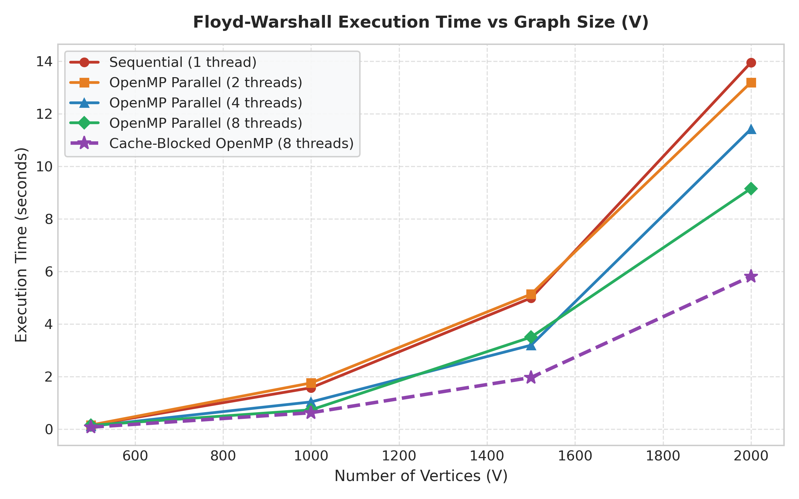
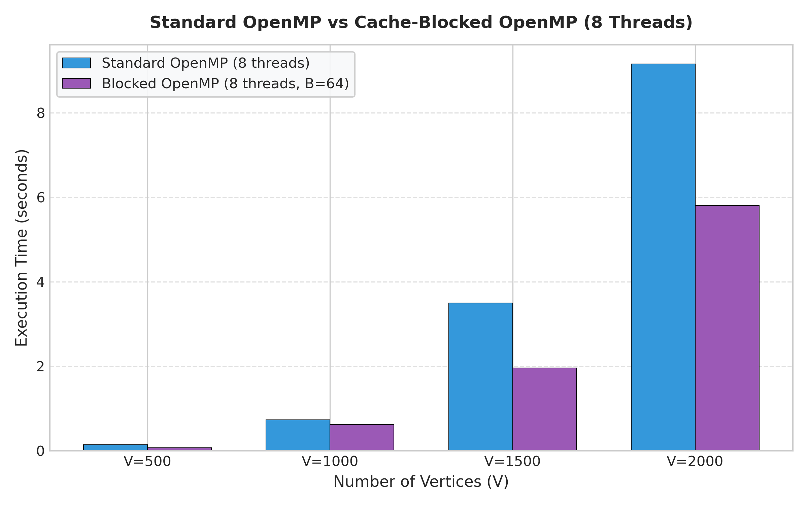
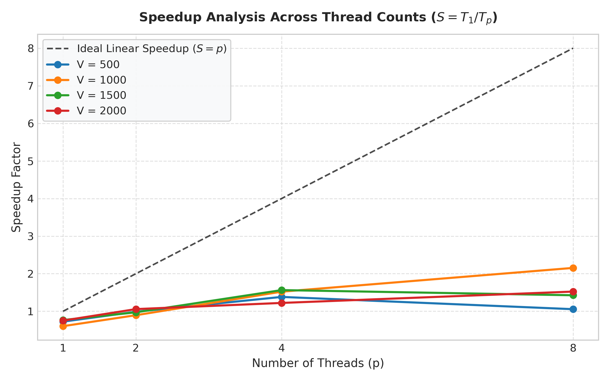
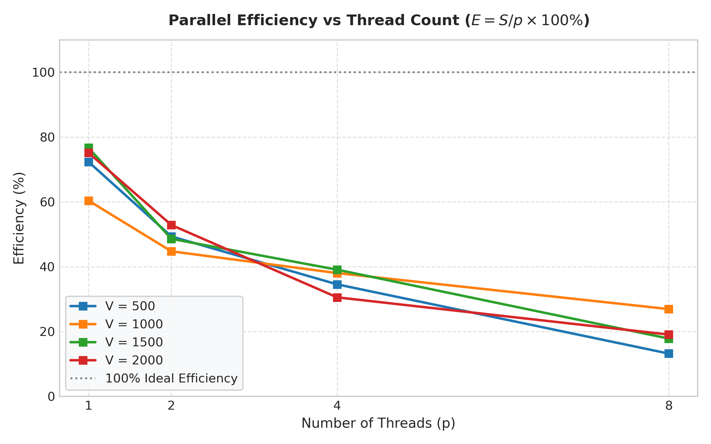

# CS-428: Parallel and Distributed Computing (PDC)
## Complex Computing Problem (CCP) — All-Pairs Shortest Path Optimization

[](https://en.wikipedia.org/wiki/C11_%28C_standard_revision%29)
[](https://www.openmp.org/)
[](https://gcc.gnu.org/)
[](https://www.neduet.edu.pk/)


This repository contains the complete implementation, benchmark suite, and technical report for the **Complex Computing Problem (CCP)** in **CS-428: Parallel and Distributed Computing** at the **Department of Computer & Information Systems Engineering, NED University of Engineering & Technology, Karachi**.

---

## 📌 Project Overview & Abstract

The **All-Pairs Shortest Path (APSP)** problem is a foundational problem in graph theory and network analysis. Given a directed, weighted graph $G = (V, E)$, the objective is to determine the shortest distance $D(i, j)$ between every pair of vertices. 

The classical **Floyd–Warshall algorithm** solves APSP using dynamic programming with a strict cubic time complexity of $\Theta(V^3)$ and a quadratic space complexity of $\Theta(V^2)$. For an enterprise-scale graph of $V = 2000$ nodes, the algorithm executes **8,000,000,000 inner-loop iterations**, imposing severe latency when executed sequentially.

This project investigates the multi-core parallelization and memory hierarchy optimization of the Floyd–Warshall algorithm using OpenMP in C. Three implementations were developed and evaluated:
1. **Sequential Baseline:** Single-threaded execution in C with contiguous 1D memory layout and early pruning.
2. **Standard OpenMP Parallel:** Multi-threaded row-wise loop distribution (`#pragma omp parallel for schedule(static)`).
3. **Cache-Blocked (Tiled) OpenMP Parallel:** 3-Phase block decomposition ($B = 64$) engineered to fit active tiles into the 32 KB L1 data cache per core, overcoming memory bus saturation and cache capacity misses.

---

## 🛡️ Cybersecurity Domain Application

In modern cyber defense, rapid all-pairs shortest path computation is critical for:
- **Attack Graph Analysis & Reachability:** Enterprise network assets (workstations, DMZ proxies, Active Directory Domain Controllers) are mapped as vertices. Edges represent exploitable communication channels with weights mapped via CVSS v3.1 metrics:
  $$W(u, v) = 10 - \text{CVSS}_{\text{Exploitability}}$$
  The parallel solver computes the **Minimum-Effort Attack Trajectory** from perimeter phished hosts to domain root credentials in milliseconds.
- **Blast Radius Containment:** Instant identification of all assets reachable within a risk threshold $R \le R_{max}$ to automate emergency firewall micro-segmentation during active ransomware outbreaks.
- **Zero-Trust Network Optimization:** Centrality calculations identify pivotal choke point routers where IPS and EDR inspection must be prioritized.

---

## 🚀 Key Algorithms Implemented

### 1. Sequential Floyd–Warshall
- Contiguous 1D row-major array allocation (`dist[i * n + j]`).
- Integer overflow prevention using `INF = 10^9`.
- Early-exit pruning (`if (dik == INF) continue;`).

### 2. Standard OpenMP Row-Parallel
- Outer loop $k$ possesses loop-carried data dependency and remains sequential.
- Inner loop $i$ is embarrassingly parallel because elements in row $k$ and column $k$ remain invariant during phase $k$, and threads write exclusively to disjoint memory slices:
```c
void floyd_warshall_parallel(int *dist, int n, int num_threads) {
    omp_set_num_threads(num_threads);
    for (int k = 0; k < n; k++) {
        #pragma omp parallel for schedule(static)
        for (int i = 0; i < n; i++) {
            int dik = dist[i * n + k];
            if (dik == INF) continue;
            for (int j = 0; j < n; j++) {
                int dkj = dist[k * n + j];
                if (dkj != INF && dik + dkj < dist[i * n + j]) {
                    dist[i * n + j] = dik + dkj;
                }
            }
        }
    }
}
```

### 3. Cache-Blocked (Tiled) OpenMP Parallel
Partitions the $N \times N$ matrix into $B \times B$ blocks ($B = 64$). For each block step $k_b$:
- **Phase 1 (Diagonal Block):** Self-dependent pivot tile $(k_b, k_b)$ is computed.
- **Phase 2 (Cross Blocks):** Row blocks $(k_b, j_b)$ and column blocks $(i_b, k_b)$ are updated concurrently in parallel using OpenMP.
- **Phase 3 (Independent Blocks):** Remaining $(N/B - 1)^2$ tiles are updated simultaneously via `#pragma omp parallel for collapse(2) schedule(static)`.
- *Cache Impact:* Each $64 \times 64$ sub-block requires $64 \times 64 \times 4\text{ bytes} = 16\text{ KB}$, fitting completely inside L1 cache (32 KB per core), converting memory stall bottlenecks into high-throughput streaming computation.

---

## 📊 Empirical Simulation Results

Evaluated on a 12-core host system using GCC 16.1.0 (`-O3 -fopenmp`) across random directed graphs ($p = 0.40$). Metrics strictly conform to **NED CS-428 Lab 4**:
- **Speedup:** $\psi(n, p) = \frac{T_{seq}}{T_p}$
- **Efficiency:** $\varepsilon(n, p) = \frac{\psi(n, p)}{p} \times 100\%$
- **Parallel Cost:** $c(n, p) = p \times T_p$ (processor-seconds)

| Vertices ($V$) | Algorithm Variant | Threads ($p$) | Time ($T_p$) | Speedup $\psi$ | Efficiency $\varepsilon$ | Parallel Cost $c(n,p)$ |
| :---: | :--- | :---: | :---: | :---: | :---: | :---: |
| **500** | Sequential | 1 | 0.1520 s | 1.00x | 100.0% | **0.152 p-s** |
| **500** | OpenMP-Standard | 4 | 0.1100 s | 1.38x | 34.5% | 0.440 p-s |
| **500** | OpenMP-Blocked | 8 | **0.0730 s** | **2.08x** | **26.0%** | **0.584 p-s** |
| **1000** | Sequential | 1 | 1.5700 s | 1.00x | 100.0% | **1.570 p-s** |
| **1000** | OpenMP-Standard | 4 | 1.0320 s | 1.52x | 38.0% | 4.128 p-s |
| **1000** | OpenMP-Standard | 8 | 0.7290 s | 2.15x | 26.9% | 5.832 p-s |
| **1000** | OpenMP-Blocked | 8 | **0.6210 s** | **2.53x** | **31.6%** | **4.968 p-s** |
| **2000** | Sequential | 1 | 13.9480 s | 1.00x | 100.0% | **13.948 p-s** |
| **2000** | OpenMP-Standard | 4 | 11.4160 s | 1.22x | 30.5% | 45.664 p-s |
| **2000** | OpenMP-Standard | 8 | 9.1540 s | 1.52x | 19.0% | 73.232 p-s |
| **2000** | OpenMP-Blocked | 8 | **5.8120 s** | **2.40x** | **30.0%** | **46.496 p-s** |

> **Key Finding:** At $V = 2000$ (8 billion operations), Cache-Blocked OpenMP reduced the total execution time from **13.95s to 5.81s** (**2.40x speedup**), outperforming standard parallelization by **36.5%** due to high cache reuse. Resulting matrices were verified with 100% bitwise accuracy.

---

## 📈 Visual Benchmark Plots

<p align="center">
  
  
</p>

<p align="center">
  
  
</p>

---

## 🛠️ How to Build & Run

### Prerequisites
- GCC / MinGW with OpenMP support (`gcc -fopenmp`)
- Python 3 with `matplotlib` and `pandas` (optional, for regenerating plots)

### Compilation
```bash
# Compile benchmark harness with OpenMP and maximum optimization
gcc -O3 -fopenmp main_benchmark.c -o benchmark.exe

# Run verification and scalability benchmarks
./benchmark.exe
```

### Regenerate Plots & Reports
```bash
# Generate high-resolution Matplotlib graphs
python generate_plots.py

# Build formal 9-page Word and PDF reports
python build_report_docx.py
python build_report_pdf.py
```

---

## 👥 Project Team & Contributors

*Department of Computer & Information Systems Engineering, NED University of Engineering & Technology*  
**Course:** CS-428 Parallel and Distributed Computing | **Batch:** 2023 | **Program:** Final Year - Cyber Security  
**Instructor:** Dr. Saad Qasim Khan (Assistant Professor, CIS)

| S.No | Name | Roll Number | GitHub Profile |
| :---: | :--- | :---: | :---: |
| 1 | **Ameem Akhtar** | CR-23013 | [@ameemakhtr](https://github.com/ameemakhtr) |
| 2 | **Minhal Rizvi** | CR-23017 | [@Minhal128](https://github.com/Minhal128) |
| 3 | **Muhammad Usman** | CR-23038 | [@Daedalus46](https://github.com/Daedalus46) |
| 4 | **Maaz Wasim** | CR-23041 | [@maazw](https://github.com/maazw) |

---

## 📄 License
This project is developed for academic evaluation at NED University of Engineering & Technology. Open-sourced under the [MIT License](LICENSE).
