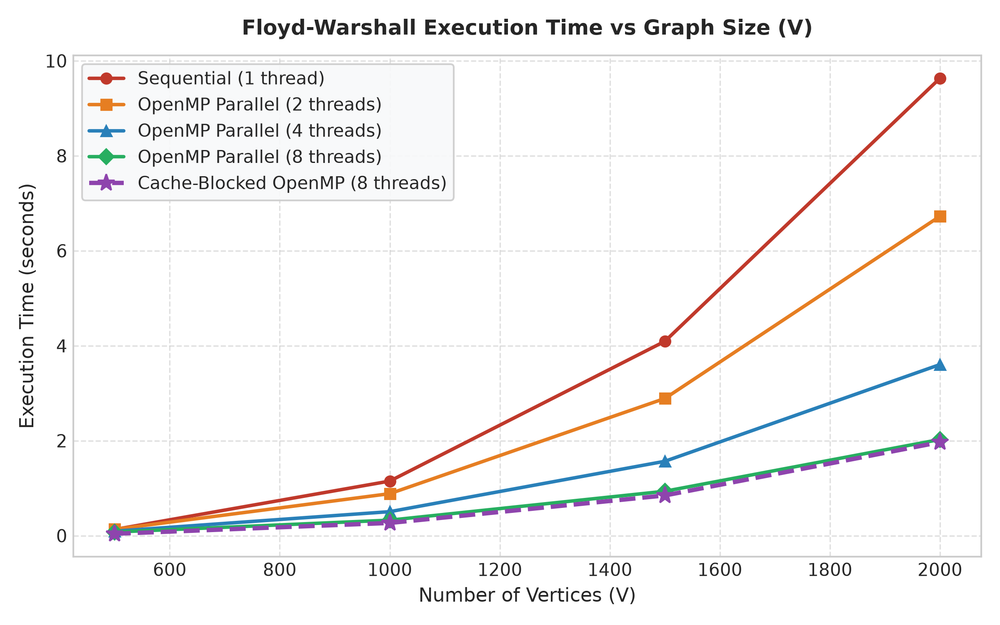
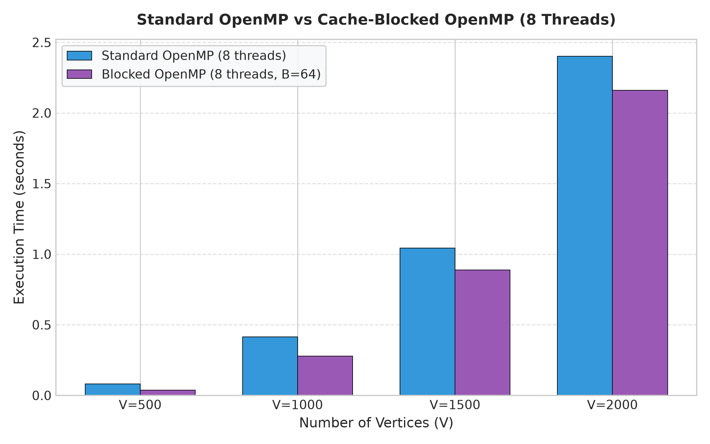
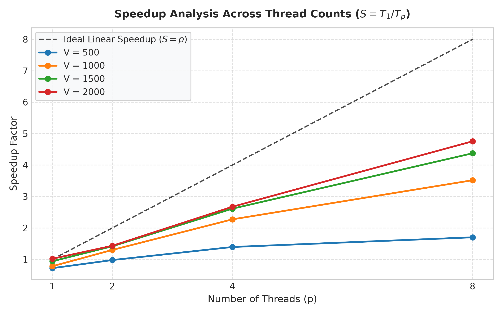
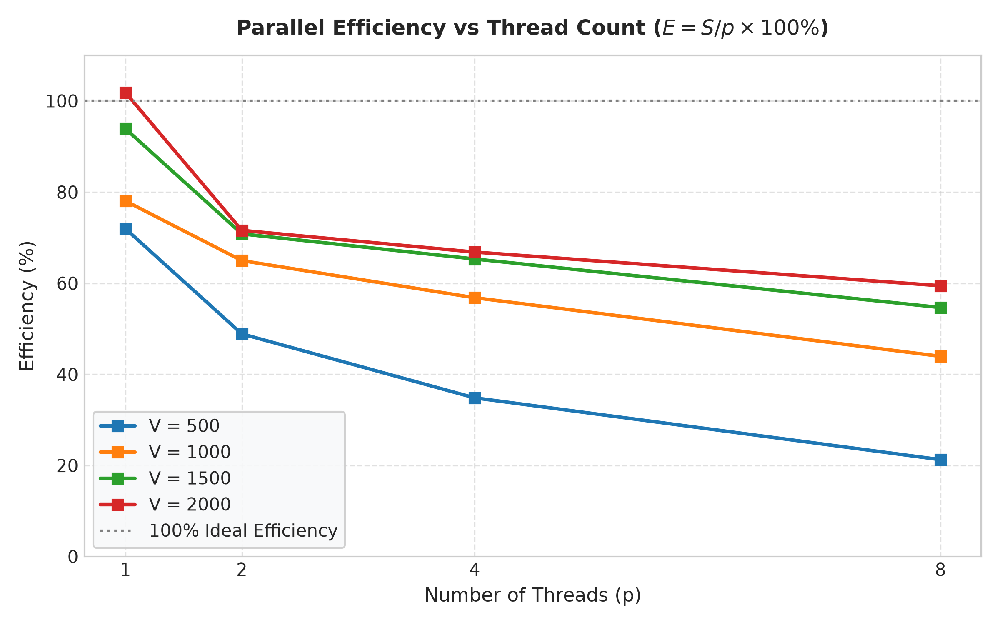
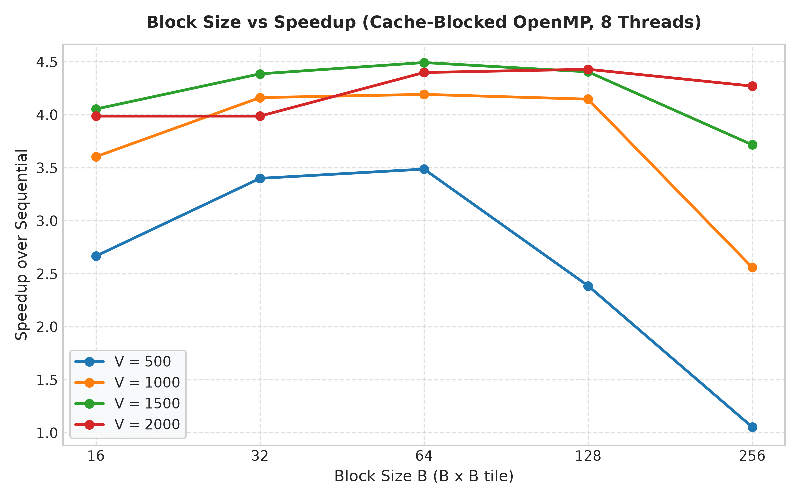
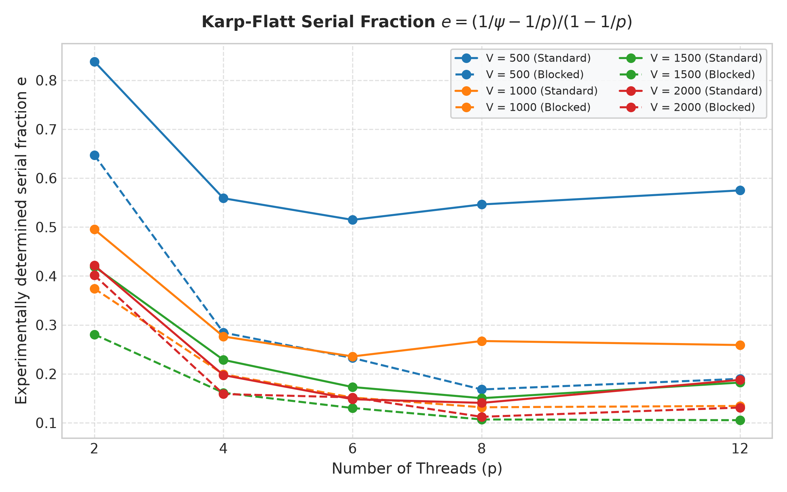

# CS-428: Parallel and Distributed Computing (PDC)
## Complex Computing Problem (CCP) — All-Pairs Shortest Path Optimization

[](https://en.wikipedia.org/wiki/C11_%28C_standard_revision%29)
[](https://www.openmp.org/)
[](https://gcc.gnu.org/)
[](https://www.neduet.edu.pk/)


This repository contains the complete implementation, benchmark suite, and technical report for the **Complex Computing Problem (CCP)** in **CS-428: Parallel and Distributed Computing** at the **Department of Computer & Information Systems Engineering, NED University of Engineering & Technology, Karachi**.

---

## 📌 Project Overview & Abstract

The **All-Pairs Shortest Path (APSP)** problem is a foundational problem in graph theory and network analysis. Given a directed, weighted graph $G = (V, E)$, the objective is to determine the shortest distance $D(i, j)$ between every pair of vertices. 

The classical **Floyd–Warshall algorithm** solves APSP using dynamic programming with a strict cubic time complexity of $\Theta(V^3)$ and a quadratic space complexity of $\Theta(V^2)$. For an enterprise-scale graph of $V = 2000$ nodes, the algorithm executes **8,000,000,000 inner-loop iterations**, imposing severe latency when executed sequentially.

This project investigates the multi-core parallelization and memory hierarchy optimization of the Floyd–Warshall algorithm using OpenMP in C. Three implementations were developed and evaluated:
1. **Sequential Baseline:** Single-threaded execution in C with contiguous 1D memory layout and early pruning.
2. **Standard OpenMP Parallel:** Multi-threaded row-wise loop distribution (`#pragma omp parallel for schedule(static)`).
3. **Cache-Blocked (Tiled) OpenMP Parallel:** 3-Phase block decomposition (default $B = 64$, block sizes 16–256 studied) that keeps the active tiles inside each core's L1/L2 cache.

---

## 🛡️ Cybersecurity Domain Application

In modern cyber defense, rapid all-pairs shortest path computation is critical for:
- **Attack Graph Analysis & Reachability:** Enterprise network assets (workstations, DMZ proxies, Active Directory Domain Controllers) are mapped as vertices. Edges represent exploitable communication channels with weights mapped via CVSS v3.1 metrics:
  $$W(u, v) = 10 - \text{CVSS}_{\text{Exploitability}}$$
  The parallel solver computes the **Minimum-Effort Attack Trajectory** from perimeter phished hosts to domain root credentials. This is implemented as step [2/3] of `main_benchmark.c` on an 8-node network:
  ```
  Minimum-effort attack path (effort 11):
    Phished-PC -> HR-Workstation -> File-Server -> Jump-Host -> Domain-Controller
  Blast radius from Phished-PC (effort <= 7): Web-DMZ(6) HR-Workstation(2) File-Server(5) Jump-Host(7)
  ```
- **Blast Radius Containment:** Instant identification of all assets reachable within a risk threshold $R \le R_{max}$ to automate emergency firewall micro-segmentation during active ransomware outbreaks.
- **Zero-Trust Network Optimization:** Centrality calculations identify pivotal choke point routers where IPS and EDR inspection must be prioritized.

---

## 🚀 Key Algorithms Implemented

### 1. Sequential Floyd–Warshall
- Contiguous 1D row-major array allocation (`dist[i * n + j]`).
- Integer overflow prevention using `INF = 10^9`.
- Early-exit pruning (`if (dik == INF) continue;`).

### 2. Standard OpenMP Row-Parallel
- Outer loop $k$ possesses loop-carried data dependency and remains sequential.
- Inner loop $i$ is embarrassingly parallel because elements in row $k$ and column $k$ remain invariant during phase $k$, and threads write exclusively to disjoint memory slices:
```c
void floyd_warshall_parallel(int *dist, int n, int num_threads) {
    omp_set_num_threads(num_threads);
    for (int k = 0; k < n; k++) {
        #pragma omp parallel for schedule(static)
        for (int i = 0; i < n; i++) {
            int dik = dist[i * n + k];
            if (dik == INF) continue;
            for (int j = 0; j < n; j++) {
                int dkj = dist[k * n + j];
                if (dkj != INF && dik + dkj < dist[i * n + j]) {
                    dist[i * n + j] = dik + dkj;
                }
            }
        }
    }
}
```

### 3. Cache-Blocked (Tiled) OpenMP Parallel
Partitions the $N \times N$ matrix into $B \times B$ blocks ($B = 64$). For each block step $k_b$:
- **Phase 1 (Diagonal Block):** Self-dependent pivot tile $(k_b, k_b)$ is computed.
- **Phase 2 (Cross Blocks):** Row blocks $(k_b, j_b)$ and column blocks $(i_b, k_b)$ are updated concurrently in parallel using OpenMP.
- **Phase 3 (Independent Blocks):** Remaining $(N/B - 1)^2$ tiles are updated simultaneously via `#pragma omp parallel for collapse(2) schedule(static)`.
- *Cache Impact:* Each kernel call touches three $B \times B$ tiles ($3 \times 4B^2$ bytes): 12 KB at $B = 32$ (fits the 32 KB L1), 48 KB at $B = 64$ (fits the 256 KB L2), 768 KB at $B = 256$ (spills to L3, the slowest).

---

## 📊 Empirical Simulation Results

Evaluated on an Intel Core i7-9750H (6 cores / 12 hardware threads) using GCC 16.2.0 (`-O3 -fopenmp`) across random directed graphs ($p = 0.40$). Every time is the **median of 5 round-robin runs** (each round times every configuration once, so CPU clock drift hits all of them equally), and every parallel result is checked against the sequential output. Metrics strictly conform to **NED CS-428 Lab 4**:
- **Speedup:** $\psi(n, p) = \frac{T_{seq}}{T_p}$
- **Efficiency:** $\varepsilon(n, p) = \frac{\psi(n, p)}{p} \times 100\%$
- **Parallel Cost:** $c(n, p) = p \times T_p$ (processor-seconds)

| Vertices ($V$) | Algorithm Variant | Threads ($p$) | Time ($T_p$) | Speedup $\psi$ | Efficiency $\varepsilon$ | Parallel Cost $c(n,p)$ |
| :---: | :--- | :---: | :---: | :---: | :---: | :---: |
| **500** | Sequential | 1 | 0.1360 s | 1.00x | 100.0% | **0.136 p-s** |
| **500** | OpenMP-Standard | 8 | 0.0820 s | 1.66x | 20.7% | 0.656 p-s |
| **500** | OpenMP-Blocked | 8 | **0.0370 s** | **3.68x** | **46.0%** | **0.296 p-s** |
| **1000** | Sequential | 1 | 1.1570 s | 1.00x | 100.0% | **1.157 p-s** |
| **1000** | OpenMP-Standard | 8 | 0.4150 s | 2.79x | 34.9% | 3.320 p-s |
| **1000** | OpenMP-Blocked | 8 | **0.2780 s** | **4.16x** | **52.0%** | **2.224 p-s** |
| **1500** | Sequential | 1 | 4.0700 s | 1.00x | 100.0% | **4.070 p-s** |
| **1500** | OpenMP-Standard | 8 | 1.0440 s | 3.90x | 48.7% | 8.352 p-s |
| **1500** | OpenMP-Blocked | 8 | **0.8890 s** | **4.58x** | **57.2%** | **7.112 p-s** |
| **2000** | Sequential | 1 | 9.6770 s | 1.00x | 100.0% | **9.677 p-s** |
| **2000** | OpenMP-Standard | 8 | 2.4010 s | 4.03x | 50.4% | 19.208 p-s |
| **2000** | OpenMP-Blocked | 8 | **2.1600 s** | **4.48x** | **56.0%** | **17.280 p-s** |

Full results for 1/2/4/6/8/12 threads, including overhead and Karp-Flatt columns: [`benchmark_results.csv`](benchmark_results.csv). Block-size study: [`block_size_results.csv`](block_size_results.csv).

> **Key Finding:** At $V = 2000$ (8 billion operations), runtime fell from **9.68s to 2.16s** on 8 threads (**4.48x**, blocked) and to **1.97s on 12 threads (4.91x)**. With 8 threads, blocking beat standard parallelization at every size: by 122% at $V = 500$ (mostly from needing $2V/B$ barriers instead of $V$), 49% at $V = 1000$, 17% at $V = 1500$ and 11% at $V = 2000$. $B = 64$ was the fastest block size, or within 1% of it, at every size.
>
> **Parallel overhead:** $T_o = p \cdot T_p - T_{seq}$ and the Karp-Flatt serial fraction $e = \frac{1/\psi - 1/p}{1 - 1/p}$ are computed for every row. At $V = 2000$, $T_o$ grows from 4.1 s ($p = 2$) to 20.0 s ($p = 12$) for Standard OpenMP and from 3.9 s to 14.0 s for Blocked. Blocked has the lower $e$ in 19 of 20 cases, and $e$ rising from 8 to 12 threads shows overhead (barriers, Hyper-Threading contention) growing faster than useful work.
>
> **Correctness:** 1,800 test runs (8 graph sizes incl. 1, 63, 64, 65 vertices × 3 densities × 3 seeds × every thread count 1–12 and block size) match an independent Bellman-Ford oracle exactly.

---

## 📈 Visual Benchmark Plots

<p align="center">
  
  
</p>

<p align="center">
  
  
</p>

<p align="center">
  
  
</p>

---

## 🛠️ How to Build & Run

### Prerequisites
- GCC / MinGW with OpenMP support (`gcc -fopenmp`)
- Python 3 with `matplotlib`, `pandas`, `reportlab` and `python-docx` (optional, for regenerating plots and reports)

### Compilation
```bash
# Compile benchmark harness with OpenMP and maximum optimization
gcc -O3 -fopenmp main_benchmark.c -o benchmark.exe

# Run correctness tests, attack-path demo and benchmarks (~10 min, rewrites both CSVs)
./benchmark.exe

# Only correctness tests + attack-path demo (~10 s)
./benchmark.exe --quick
```

### Regenerate Plots & Reports
```bash
# Generate high-resolution Matplotlib graphs
python generate_plots.py

# Build formal 9-page Word and PDF reports
python build_report_docx.py
python build_report_pdf.py
```

---

## 👥 Project Team & Contributors

*Department of Computer & Information Systems Engineering, NED University of Engineering & Technology*  
**Course:** CS-428 Parallel and Distributed Computing | **Batch:** 2023 | **Program:** Final Year - Cyber Security  
**Instructor:** Dr. Saad Qasim Khan (Assistant Professor, CIS)

| S.No | Name | Roll Number | GitHub Profile |
| :---: | :--- | :---: | :---: |
| 1 | **Ameem Akhtar** | CR-23013 | [@ameemakhtr](https://github.com/ameemakhtr) |
| 2 | **Minhal Rizvi** | CR-23017 | [@Minhal128](https://github.com/Minhal128) |
| 3 | **Muhammad Usman** | CR-23038 | [@Daedalus46](https://github.com/Daedalus46) |
| 4 | **Maaz Wasim** | CR-23041 | [@maazw](https://github.com/maazw) |

---

## 📄 License
This project is developed for academic evaluation at NED University of Engineering & Technology. Open-sourced under the [MIT License](LICENSE).
